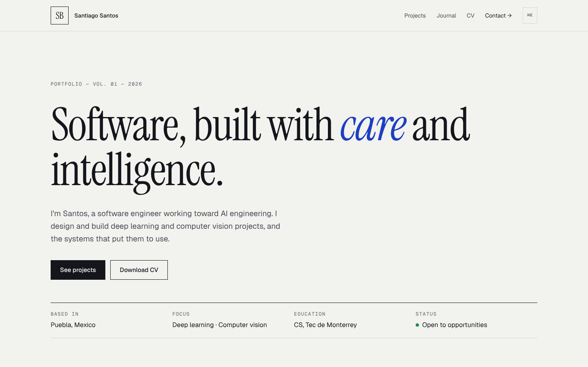
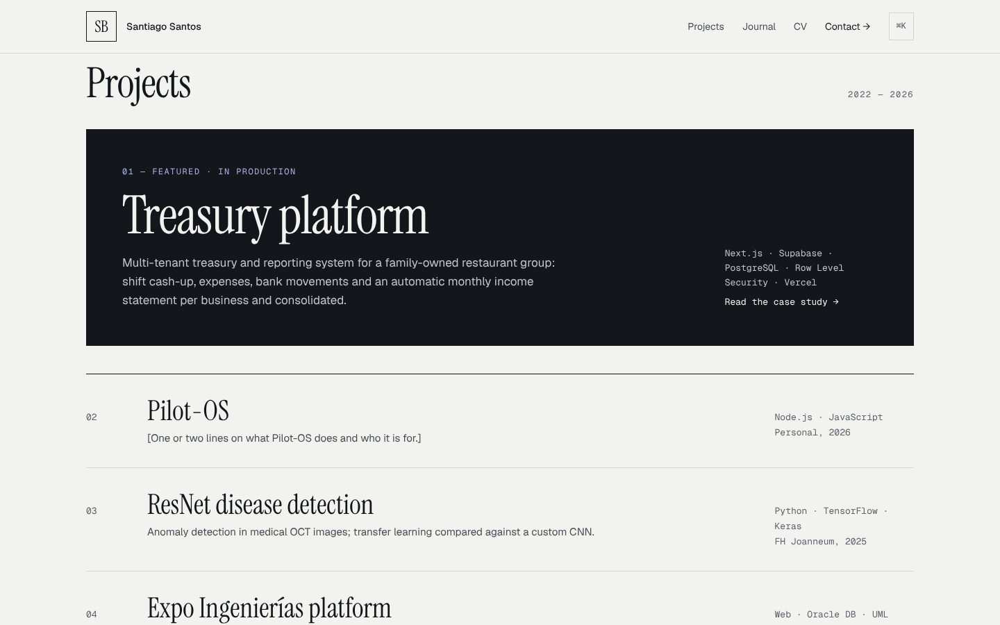
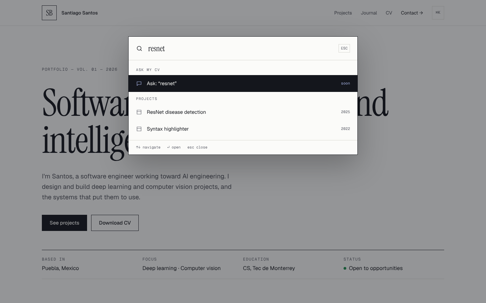

<div align="center">

# Santiago Santos — Portfolio

**Software, built with _care_ and intelligence.**

[sansantos.com](https://sansantos.com) · [LinkedIn](https://www.linkedin.com/in/santossanb) · [GitHub](https://github.com/sansantoss)

<br>

<picture>
  <source media="(prefers-color-scheme: dark)" srcset="docs/hero-dark.png">
  
</picture>

</div>

---

An editorial portfolio: the look of an architecture studio, the function of a CV. Projects, a build journal and a command palette, with content edited from a git-backed CMS. There is no database.

<table>
  <tr>
    <td width="50%"></td>
    <td width="50%"></td>
  </tr>
  <tr>
    <td align="center"><sub>Projects: featured case study and editorial list with hover previews</sub></td>
    <td align="center"><sub>⌘K command palette: search, navigate, copy email, switch theme</sub></td>
  </tr>
</table>

## Highlights

- **Git-backed CMS**: [Keystatic](https://keystatic.com) edits Markdown and JSON in `content/`. Every save in production is a commit, and Vercel redeploys on its own.
- **⌘K command palette**: built with [cmdk](https://cmdk.paco.me). It searches projects and posts and runs actions. Opens with `⌘K`, `Ctrl+K` or `/`.
- **Scroll-driven reveals in pure CSS**: `animation-timeline: view()`, no JavaScript, turned off under `prefers-reduced-motion`.
- **Light and dark themes**: follows the system, can be switched from the palette, and is remembered without a flash on load.
- **Static and fast**: every page is pre-rendered and the fonts are self-hosted.
- **A drone that rides along**: on wide screens a 3D drone (three.js) starts in the hero, flies down the right margin as you scroll and parks beside *Ask my CV*. It fades out instead of covering text, loads only on desktop and respects `prefers-reduced-motion`. It also guards the 404.
- **Accessible**: semantic markup, a skip link, keyboard-first navigation and visible focus.

## Stack

| Layer | Choice |
| --- | --- |
| Framework | Next.js 16 (App Router), React 19, TypeScript |
| Content | Keystatic (local in development, GitHub in production), Markdoc |
| UI | Hand-written CSS with design tokens, cmdk |
| Type | Instrument Serif · Geist · Geist Mono |
| Hosting | Vercel |

## Run it locally

Requires Node 20.9+.

```bash
npm install
npm run dev
```

| URL | What |
| --- | --- |
| http://localhost:3000 | The site |
| http://localhost:3000/keystatic | The editor (no login in local mode, writes straight to `content/`) |

## Editing content

| Content | In the editor | In code |
| --- | --- | --- |
| Name, headline, intro, links, CV PDF | Settings → Profile | `content/profile.json` |
| CV timeline, stack, languages | Settings → CV | `content/cv.json` |
| Projects | Content → Projects | `content/projects/*.mdoc` |
| Journal posts | Content → Journal | `content/posts/*.mdoc` |

Project fields worth knowing:

- **Order** sets the position in the list.
- **Featured** shows the project as the large dark card. Mark only one.
- **Hidden** removes it from the site without deleting it.
- **Preview image** follows the cursor in the list and appears at the top of the project page. Use 16:9 at about 1600 px wide.
- **Preview video** takes a short, muted `.mp4` and replaces the image on the project page.

New posts start as **Draft** and only go live when you uncheck it.

## Deploy

1. Push to `github.com/sansantoss/portafoliosantiagosantos`.
2. In Vercel, go to **Add New → Project** and import the repo. The defaults work.
3. Under **Settings → Domains**, add `sansantos.com` and `www.sansantos.com`, then copy the DNS records into your domain registrar.

### Editing in production

The editor at `sansantos.com/keystatic` signs in with GitHub and commits to this repo. Set it up once:

1. Create `.env.local` with `NEXT_PUBLIC_KEYSTATIC_STORAGE=github`.
2. Run `npm run dev` and open `/keystatic`. It walks you through creating a GitHub App and writes `KEYSTATIC_GITHUB_CLIENT_ID`, `KEYSTATIC_GITHUB_CLIENT_SECRET`, `KEYSTATIC_SECRET` and `NEXT_PUBLIC_KEYSTATIC_GITHUB_APP_SLUG` to `.env.local`.
3. Copy all five variables to **Vercel → Settings → Environment Variables** and redeploy.
4. In the GitHub App settings, add the callback URL `https://sansantos.com/api/keystatic/github/oauth/callback`.

> `.env*` files are git-ignored. Never commit keys.

## Project structure

```
content/            ← everything you edit (profile, CV, projects, posts)
public/files/       ← CV PDF
public/images/      ← project previews (uploaded from the editor)
src/app/(site)/     ← pages: home, projects/[slug], journal, journal/[slug]
src/app/keystatic/  ← editor UI
src/components/     ← command palette, project list, theme, toast
keystatic.config.ts ← content schema
```

## Credits

- 404 drone: *Eye Drone* from the [Sci-Fi Essentials Kit](https://quaternius.com) by Quaternius (CC0), eye recoloured to the site accent and compressed to ~220 KB.

## Roadmap

- [x] v1: editorial site, CMS, command palette, themes
- [ ] v2: **Ask my CV**, retrieval-augmented answers over this repo's content, with citations
- [ ] v3: write-ups for every project, Open Graph images, analytics

---

<div align="center"><sub>Designed and built by Santiago Santos · Puebla, Mexico</sub></div>
